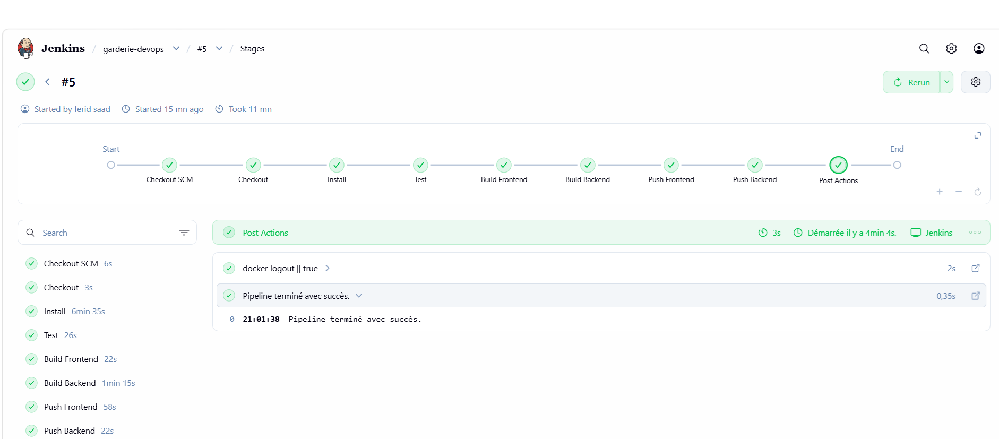
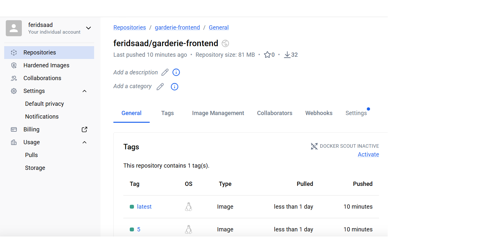
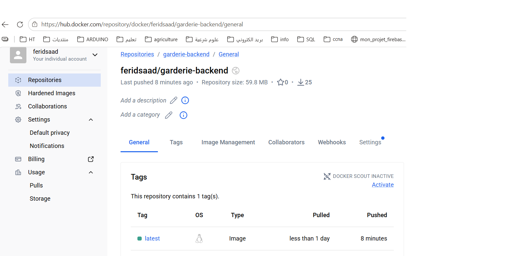
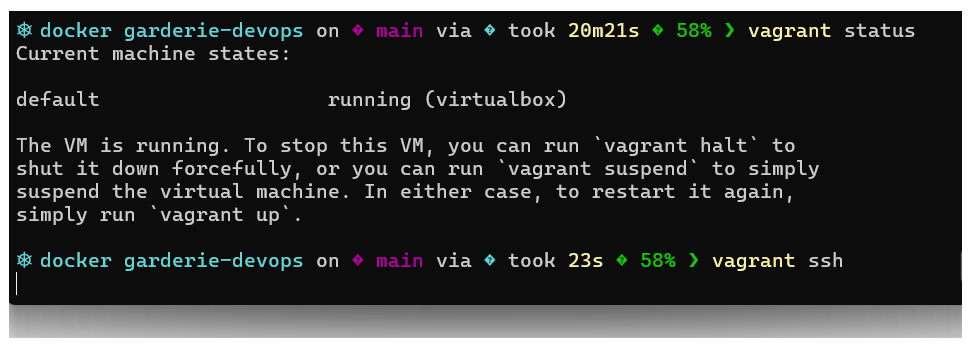
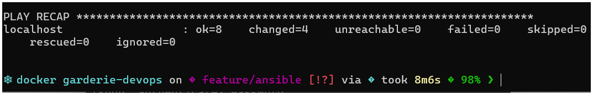
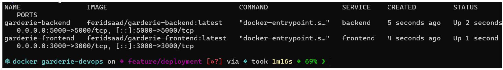

# Ma Garderie : chaîne CI/CD Jenkins, Docker, Vagrant et Ansible

Application Web de présentation d'une garderie d'enfants, livrée par une chaîne CI/CD complète : tests et construction des images avec **Jenkins**, publication sur **Docker Hub**, création de la VM avec **Vagrant**, installation de Docker avec **Ansible**, puis déploiement avec **Docker Compose**.

- Dépôt GitHub : https://github.com/ferid-saad/garderie-devops
- Image frontend : https://hub.docker.com/r/feridsaad/garderie-frontend
- Image backend : https://hub.docker.com/r/feridsaad/garderie-backend

## 1. Présentation et technologies

La landing page affiche trois composants (Navbar, Hero, Services) dont les données viennent d'une API REST.

| Couche | Technologie |
|---|---|
| Frontend | Next.js (React), rendu côté serveur |
| Backend | Node.js et Express (API REST, CORS) |
| Test | Jest et Testing Library |
| Conteneurs | Docker et Docker Compose |
| CI/CD | Jenkins (Pipeline as Code, `Jenkinsfile`) |
| Registre | Docker Hub |
| Machine virtuelle | Vagrant et VirtualBox (Ubuntu Server 22.04) |
| Provisioning | Ansible (rôle `docker`) |

### API REST du backend

| Méthode | Route | Contenu |
|---|---|---|
| GET | `/api/garderie` | Informations générales |
| GET | `/api/services` | Liste des services |
| GET | `/api/activites` | Liste des activités |

## 2. Architecture
garderie-devops/
├── backend/ API Express + Dockerfile
├── frontend/ Application Next.js + Dockerfile + test Jest
├── ansible/ Inventaire, playbook site.yml, rôle docker
├── screenshots/ Captures d’écran
├── Jenkinsfile Pipeline CI/CD
├── Vagrantfile Définition de la VM
├── docker-compose.yml Déploiement (images Docker Hub)
├── docker-compose.dev.yml Développement local (construction des images)
└── README.md

### Chaîne CI/CD
GitHub -> Jenkins -> Docker Hub -> VM Vagrant (Docker Compose)
(code) (test, build, (images) provisionnée par Ansible
push)


1. Le code est poussé sur GitHub (branche `main`).
2. Jenkins récupère le code, installe les dépendances, exécute le test, construit et publie les deux images.
3. Vagrant crée la VM et lance Ansible, qui y installe Docker et le plugin Compose.
4. Docker Compose télécharge les images depuis Docker Hub et démarre les conteneurs, sans reconstruction locale.

Les conteneurs communiquent par le réseau Docker `garderie-net`. Le frontend joint le backend à l'adresse `http://backend:5000`, donnée par la variable `BACKEND_URL`, lue au démarrage du conteneur.

## 3. Lancer l'application en local (développement)

```bash
docker compose -f docker-compose.dev.yml up --build -d
```

Application : http://localhost:3000. Pour arrêter : `docker compose -f docker-compose.dev.yml down`.

Test automatisé :

```bash
cd frontend
npm ci
npm test
```

## 4. Pipeline Jenkins

Le pipeline est défini dans le fichier `Jenkinsfile` à la racine (Pipeline as Code).

| Étape | Rôle |
|---|---|
| Checkout | Récupère le code depuis GitHub |
| Install | `npm ci` dans `frontend` |
| Test | `npm test` : le pipeline s'interrompt en cas d'échec |
| Build Frontend | Construit l'image `feridsaad/garderie-frontend` |
| Build Backend | Construit l'image `feridsaad/garderie-backend` |
| Push Frontend | Publie l'image sur Docker Hub |
| Push Backend | Publie l'image sur Docker Hub |

Les images reçoivent deux tags : le numéro du build et `latest`.

### Exécution

1. Dans Jenkins, créer l'identifiant **`dockerhub-creds`** (*Manage Jenkins, Credentials, Global*), de type *Username with password* : identifiant Docker Hub et **token d'accès** avec droits Read & Write. Aucun mot de passe n'est écrit dans le dépôt.
2. Créer un job de type **Pipeline** avec *Pipeline script from SCM*, Git, l'URL du dépôt, la branche `*/main` et le chemin `Jenkinsfile`.
3. Lancer **Build Now**.

Prérequis sur le serveur Jenkins : Git, Node.js, Docker, et l'utilisateur `jenkins` membre du groupe `docker`.







## 5. Création et provisioning de la VM

| Caractéristique | Valeur |
|---|---|
| Système | Ubuntu Server 22.04 (`ubuntu/jammy64`) |
| RAM | 2 Go |
| CPU | 2 vCPU |
| Réseau privé | IP fixe `192.168.56.10` |
| Ports redirigés | 3000 (frontend) et 5000 (backend) vers l'hôte |

Prérequis : VirtualBox et Vagrant. Prévoir environ 10 Go d'espace libre sur le disque qui contient les VM.

```bash
vagrant up          # crée la VM et lance le provisioning Ansible
vagrant ssh         # connexion SSH
vagrant provision   # rejoue uniquement le provisioning
```

### Provisioning Ansible

Vagrant utilise le provisioner `ansible_local` : Ansible est installé dans la VM et exécute `ansible/site.yml`. Le rôle `ansible/roles/docker` :

- installe Docker Engine depuis le dépôt officiel de Docker,
- installe le plugin Docker Compose,
- démarre et active le service Docker,
- ajoute l'utilisateur de déploiement (`vagrant`) au groupe `docker`.

Vérification :

```bash
vagrant ssh -c "docker --version && docker compose version && systemctl is-active docker"
```





## 6. Déploiement avec Docker Compose

Le fichier `docker-compose.yml` utilise uniquement les images publiées sur Docker Hub, sans reconstruction :

```bash
vagrant ssh -c "cd /vagrant && docker compose pull && docker compose up -d && docker compose ps"
```

Vérification des trois API :

```bash
curl http://192.168.56.10:5000/api/garderie
curl http://192.168.56.10:5000/api/services
curl http://192.168.56.10:5000/api/activites
```



## 7. Accès à l'application déployée

| Depuis | Adresse |
|---|---|
| Le PC hôte | http://192.168.56.10:3000 |
| Une autre machine du réseau | `http://<adresse IP du PC hôte>:3000` (exemple : http://192.168.100.24:3000) |

Les ports 3000 et 5000 de la VM sont redirigés vers le PC hôte, qui doit les autoriser dans son pare-feu. L'adresse du PC hôte dépend du réseau Wi-Fi : la relever avec `ipconfig` (Windows) avant l'utilisation.


## 8. Branches Git

| Branche | Contenu |
|---|---|
| `feature/vagrant` | Vagrantfile |
| `feature/ansible` | Structure Ansible et rôle `docker` |
| `feature/deployment` | `docker-compose.yml` de déploiement |
| `docs/readme` | Documentation et captures d'écran |

Toutes les branches sont fusionnées dans `main`.